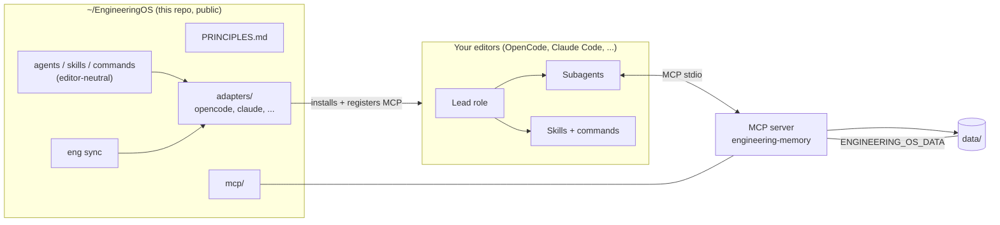
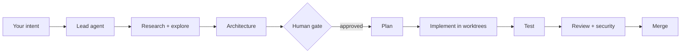
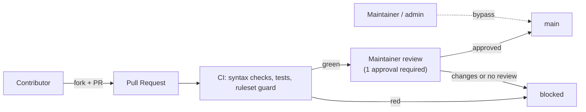

# EngineeringOS

A local-first **engineering operating system** for AI coding agents: a shared
context, memory, and state layer that sits under tools like OpenCode, Codex, or
Claude Code. The coding tool is the execution surface; EngineeringOS is the
system of record, so your agents stop forgetting everything between sessions.

It keeps durable, searchable memory across projects, architecture docs, ADRs,
technical research, and task state, and exposes it to agents through a small
local MCP server.

- **Public engine, private data.** This repository is the engine and contains no
  personal data. Everything you know lives in a separate data directory you
  version-control privately.
- **No dependencies.** The MCP server and the editor adapters are stdlib-only
  Python, and the CLI is one `bash` entry point. Nothing to `pip install`, no
  daemon, no cloud.
- **Agents with defined jobs.** A lead orchestrator delegates to specialized
  read-only and write agents instead of one super-agent doing everything.
- **Any editor.** Agents, skills and commands are written once in an
  editor-neutral format; adapters install them into OpenCode and Claude Code
  today, and more editors are one adapter each.

---

## Contents

- [How it works](#how-it-works)
- [Quick start](#quick-start)
- [Everyday usage](#everyday-usage)
- [The agents](#the-agents)
- [The skills](#the-skills)
- [The commands](#the-commands)
- [The MCP server](#the-mcp-server)
- [The `eng` CLI](#the-eng-cli)
- [Editors](#editors)
- [Engine layout](#engine-layout)
- [Split: public engine vs private data](#split-public-engine-vs-private-data)
- [Branch protection and contributing](#branch-protection-and-contributing)
- [Uninstall](#uninstall)
- [License](#license)

---

## How it works

Two directories, one environment variable between them:



The engine ships the rules, agent definitions, skills, commands, the MCP server,
and the CLI. Your data directory holds everything specific to you. Agents, skills
and commands are written once in an **editor-neutral** format (`agents/`,
`skills/`, `commands/`). Per-editor **adapters** (`adapters/<editor>/`) render
them into each tool's own format and register the MCP server there with
`$ENGINEERING_OS_DATA` pointing at your data. `eng setup` runs every adapter
whose editor is installed. Today: OpenCode and Claude Code. See
[docs/adapters.md](docs/adapters.md) to add another.

Markdown is the source of truth. The SQLite database is a search index (FTS5
where available) and can be rebuilt. If the DB is lost, search falls back to
grepping the markdown.

---

## Quick start

**Requirements:** `git`, `python3` 3.9+ (with the `sqlite3` module), `bash`, and
[OpenCode](https://opencode.ai) and/or [Claude Code](https://claude.com/claude-code)
(CLI or desktop app). `eng setup` wires up whichever it finds. `gh` is optional, only needed for the
`repo-protect` command.

```sh
# 1. Clone the engine
git clone https://github.com/Ay7ot/engineering-os.git ~/EngineeringOS

# 2. Bootstrap everything (idempotent, safe to re-run)
~/EngineeringOS/scripts/eng setup

# 3. Restart your editors (OpenCode, Claude Code) so they load the new agents, skills, commands, and MCP
```

`eng setup` does all of this for you:

- checks `git` and `python3`, detects which editors you have, and verifies `sqlite3` is importable
- creates `~/EngineeringOS/data` with the standard layout
- seeds your `USER.md` from `USER.example.md` if you do not have one
- runs each installed editor's adapter: installs agents, skills, and commands
  in that editor's format, registers the `engineering-memory` MCP server, and
  makes the `lead` role the default (only if you have not chosen your own)
- adds an `eng` shell alias to your `.zshrc` or `.bashrc`
- runs health checks and prints what it found

Then make it yours:

```sh
$EDITOR ~/EngineeringOS/data/USER.md    # who you are, how you work, approval gates
```

Optionally, put your data under version control in a **private** repo so you can
restore everything after a machine reset:

```sh
cd ~/EngineeringOS/data
git init && git add -A && git commit -m "chore: initial EngineeringOS data"
gh repo create engineering-os-data --private --source=. --push
```

### Restore after a machine reset

```sh
git clone https://github.com/Ay7ot/engineering-os.git ~/EngineeringOS
git clone <your-private-data-repo> ~/EngineeringOS/data
~/EngineeringOS/scripts/eng setup
```

---

## Everyday usage

Open your editor in a project and work through the lead role, either directly
or through a command. In OpenCode, `lead` is the default agent. In Claude Code,
the **EngineeringOS Lead** output style is the default mode for every session.
You provide intent and approve consequential decisions; the agents do research,
exploration, architecture, implementation, testing, review, and bookkeeping.



A typical first run on an existing project:

```sh
cd /path/to/your/project
opencode        # or: claude (or open the folder in the Claude desktop app)
> /init-project
```

That maps the workspace, writes an `AGENTS.md`, and registers the project in
EngineeringOS memory.

---

## The agents

The lead agent classifies each task and picks the smallest safe workflow, so a
typo fix does not spin up nine agents.

| Agent | Role | Model tier | What it does | Can write code? |
|---|---|---|---|---|
| **lead** | primary | deep | Orchestrates; classifies complexity; delegates; manages approval gates; final report | yes |
| **researcher** | subagent | standard | Technical research from primary sources; persists reusable findings | no (writes research only) |
| **explorer** | subagent | fast | Maps repositories and non-git workspaces; produces repo maps, not dumps | no |
| **architect** | subagent | deep | Architecture proposals, alternatives, tradeoffs, ADRs, diagrams | markdown only |
| **planner** | subagent | standard | Turns approved architecture into small, verifiable tasks | no |
| **builder** | subagent | standard | Implements the approved plan; stops and reports on architectural problems | yes |
| **tester** | subagent | standard | Writes tests, runs typecheck/lint/test/build, reports PASS/FAIL evidence | tests only |
| **reviewer** | subagent | deep | Adversarial review; finds reasons NOT to merge | no |
| **security** | subagent | deep | Security review of auth, data, secrets, injection, dependencies | no |

The primary role becomes OpenCode's default agent and Claude Code's default
output style. Each editor maps the model tier to its own models (see
[Editors](#editors)).

Read-only agents are locked down at the permission level: `edit` is denied
(the architect may edit markdown only), and `bash` is denied except an explicit
list of read-only commands. Git stays read-only for them: push, reset, branch
deletion, remote changes and file-writing flags like `--output` are denied. In
OpenCode the permission maps enforce this; in Claude Code a guard hook enforces
the same rules and blocks on any error.

**Workflows by complexity:**

| Complexity | Workflow |
|---|---|
| Simple | Do it directly, verify |
| Moderate | builder → tester |
| Important | explorer → builder → reviewer → tester |
| Complex | researcher + explorer → architect → **human gate** → planner → builders (parallel worktrees) → tester → reviewer → security → **human gate** if needed |

The human gate always stops for: major architecture decisions, destructive DB
migrations, production deploys, security-sensitive changes, irreversible data
operations, significant infrastructure changes, major product behavior, and
substantial cost. Everything else is inferred autonomously.

---

## The skills

Skills are playbooks loaded by agents when a task matches. They are plain
markdown, easy to read and copy. The full catalogue, with the trigger line for
each skill and its provenance, is in **[docs/skills.md](docs/skills.md)**.

They fall into six groups:

- **Core engineering** - `api-design`, `architecture-analysis`, `backend-architecture`,
  `code-review`, `database-design`, `dataviz`, `debugging`, `diagrams`,
  `documentation`, `frontend-architecture`, `git-workflow`, `memory-hygiene`,
  `observability`, `payments`, `project-planning`, `repository-exploration`,
  `security-review`, `simplify`, `skill-authoring`, `technical-research`, `testing`.
- **Design, frontend and design systems** - `frontend-design`, `design-taste-frontend`,
  `minimalist-ui`, `high-end-visual-design`, `redesign-existing-projects`,
  `better-typography`, `better-colors`, `better-layout`, `better-ui`,
  `tailwind-design-system`, `shadcn`, `create-design-md`, `web-interface-guidelines`.
- **Motion and accessibility** - `apple-design`, `animate`, `review-animations`,
  `break-ui`, `animation-vocabulary`, `improve-animations`,
  `find-animation-opportunities`, `wcag-accessibility`, `better-accessibility`,
  `accessibility-expert`.
- **Product, discovery and AI product** - `brainstorming`, `to-prd`, `writing-plans`,
  `prototype`, `triage`, `to-issues`, `wayfinder`, `opportunity-solution-tree`,
  `user-research`, `usability-testing`, `ai-evals`, `pm-handoff`.
- **Engineering process** - `test-driven-development`, `verification-before-completion`,
  `subagent-driven-development`, `dispatching-parallel-agents`, `karpathy-guidelines`,
  `using-git-worktrees`, `executing-plans`.
- **Marketing and GTM** - `copywriting`, `copy-editing`, `page-cro`, `onboarding-cro`,
  `seo-audit`, `ai-seo`, `schema-markup`, `analytics`, `ab-testing`, `emails`,
  `cold-email`, `launch`.

Many of the non-core skills are distillations of the
[aiuxplayground.com skills catalogue](https://aiuxplayground.com/skills). Each
carries `metadata.upstream` and `metadata.license`; only permissively licensed
sources were adopted (see [docs/skills.md](docs/skills.md)).

In Claude Code, `code-review`, `security-review`, `simplify`, `dataviz` and
`frontend-design` are installed with an `eos-` prefix (`eos-code-review`, ...) so
they do not shadow Claude Code's own skills.

---

## The commands

Slash commands that run a full workflow through the lead role, in every editor.
Two are renamed in Claude Code to avoid its built-in commands.

| Command | Claude Code name | What it does |
|---|---|---|
| `/init-project` | same | Map the workspace, write `AGENTS.md`, register the project |
| `/feature` | same | Full feature workflow: explore, research, architect, plan, build, test, review |
| `/research` | same | Technical research, persisted to EngineeringOS |
| `/debug` | `/eos-debug` | Investigate, reproduce, test hypotheses, fix, regression-test |
| `/review` | `/eos-review` | Review current changes, a branch, a PR, or specific files |
| `/worktree` | same | Create, list, or close git worktrees for features and bug fixes |

---

## The MCP server

`mcp/engineering-memory/server.py` is a stdlib-only MCP server over stdio. It
exposes 13 tools:

| Tool | Purpose |
|---|---|
| `search_knowledge` | Full-text search across knowledge, decisions, research, project docs |
| `get_project_context` | Full project context: context, architecture, state, recent activity |
| `get_project_state` | Current state plus open tasks |
| `update_project_state` | Append a state entry; creates the project if missing |
| `search_decisions` / `get_decision` / `record_decision` | Architecture Decision Records |
| `search_research` / `get_research` / `record_research` | Persisted technical research |
| `get_active_tasks` / `record_task` / `update_task` | The task blackboard |

Test it directly:

```sh
printf '{"jsonrpc":"2.0","id":1,"method":"tools/list","params":{}}\n' \
  | ENGINEERING_OS_DATA=~/EngineeringOS/data python3 mcp/engineering-memory/server.py
```

---

## The `eng` CLI

`scripts/eng` is the single entry point (bash). Editor sync and health are
handled by `scripts/eos_sync.py` and the adapters (stdlib Python). Every command
is idempotent: re-running changes nothing that is already correct.

```sh
eng setup                            # bootstrap deps, data, config, MCP, health
eng health                           # verify engine, data, MCP, agents, skills
eng sync [all|<editor>]              # render + install for installed editors (default all)
eng sync-opencode                    # alias: eng sync opencode
eng sync-claude                      # alias: eng sync claude
eng targets                          # list known editors and whether each is installed
eng worktree new <name> [--type fix] # isolated worktree per feature/bug
eng worktree list                    # show active and closed worktrees
eng worktree close <name>            # remove it (refuses if dirty)
eng repo-protect --check             # show branch-protection drift vs GitHub
eng repo-protect                     # apply .github/ruleset.json
```

Worktrees use a sibling path (`../<repo>-<slug>-wt`), auto-detect the base
branch, register themselves in `projects/<name>/worktrees.md`, and refuse to
close over uncommitted changes unless you pass `--force`. One writer per
worktree, never two.

---

## Editors

Agents, skills and commands live once in `agents/`, `skills/` and `commands/`
in an editor-neutral format. Each editor has an **adapter** in
`adapters/<editor>/` that renders them into that editor's format, installs
them, and registers the `engineering-memory` MCP server. `eng sync` (and
`eng setup`) runs every adapter whose editor is installed; `eng targets` shows
which those are.

Shared rules for every adapter:

- **Never overwrite your files.** Generated files are tracked in a manifest in
  the editor's config dir. A file sync did not write is reported as `SKIPPED`
  and left alone; files it no longer produces are pruned.
- **Fail closed on permissions.** Only an exact `allow` grants a capability.
- **Merge shared configs, never replace them.** The first backup
  (`*.engineeringos.bak`) of each config file is kept.
- **Edit the sources, not the output.** Change `agents/`, `skills/`,
  `commands/`, then run `eng sync` and restart your editors.

| Editor | Installs into | Status |
|---|---|---|
| OpenCode | `~/.config/opencode/` | supported |
| Claude Code | `~/.claude/`, `~/.claude.json` | supported |
| Codex, Cursor, Gemini CLI, ... | | add an adapter: [docs/adapters.md](docs/adapters.md) |

### Claude Code

The Claude Code adapter (`adapters/claude/`, run by `eng sync claude` and by
`eng setup` when `~/.claude` or the `claude` CLI exists) renders the same
neutral sources, so every editor shares one engine and one memory:

| EngineeringOS | Claude Code |
|---|---|
| `agents/*.md` (`role: subagent`) | `~/.claude/agents/*.md`. `permissions:` becomes `disallowedTools` plus a `PreToolUse` hook (`adapters/claude/hooks/eos_guard.py`) that enforces bash/edit allowlists, so read-only agents stay read-only. Translation fails closed: only an exact `allow` grants a capability (`ask` becomes deny). The guard also keeps git read-only for allowlisted agents (no push/reset/branch -D/--output, even under `git *`) and blocks edits to Claude Code config. Models come from `model_tier` (deep → opus, standard → sonnet, fast → haiku) unless `targets.claude.model` overrides |
| `agents/lead.md` (`role: primary`) | The **EngineeringOS Lead** output style (`~/.claude/output-styles/eos-lead.md`, keeps Claude Code's coding instructions), set as the default `outputStyle` in `~/.claude/settings.json` unless you already chose another style. Switch per session in the app or with `/output-style` |
| always-on context | A managed block in `~/.claude/CLAUDE.md` importing `PRINCIPLES.md` and `USER.md`, plus the memory and `AGENTS.md` rules. Your own CLAUDE.md content is kept |
| `skills/` | `~/.claude/skills/` |
| `commands/` | `~/.claude/commands/` |
| `engineering-memory` MCP | user-scope server, registered with `claude mcp add-json` when the CLI is on PATH; otherwise merged into `~/.claude.json` (backup at `~/.claude.json.engineeringos.bak`; restart Claude Code and re-run `eng health` if it was open) |

Names that collide with an editor's own skill or command get an `eos-` prefix:
the `eos-code-review`, `eos-security-review`, `eos-simplify`, `eos-dataviz` and
`eos-frontend-design` skills, and the `/eos-review` and `/eos-debug` commands.
Respects `CLAUDE_CONFIG_DIR`.

To switch a single session out of the Lead mode, change its output style back
to Default (session menu in the desktop app, or `/output-style` in the
terminal). To stop making it the default, set a different `outputStyle` in
`~/.claude/settings.json`; sync leaves an existing choice alone.

### OpenCode

The OpenCode adapter (`adapters/opencode/`) writes `~/.config/opencode/`
(respects `XDG_CONFIG_HOME`). It renders `role` as `mode`, `permissions` as
`permission`, and passes `targets.opencode.*` (model, temperature, command
`agent`/`subtask`) through. It registers the MCP server in the shape your
OpenCode reads: `mcp.servers.<name>` for v2, `mcp.<name>` for v1. It also removes
the stale v1 entry older `eng` versions wrote. Ownership works like the Claude
adapter (manifest, `SKIPPED` for files it did not write). On the first run it
adopts files the old copy-based sync installed. `lead` becomes `default_agent`
only if you have not set your own.

---

## Engine layout

```
~/EngineeringOS/
  PRINCIPLES.md          global engineering rules every agent follows
  USER.example.md        template for your private operator profile
  agents/                editor-neutral agent definitions (lead + 8 subagents)
  skills/<name>/         playbooks (SKILL.md)
  commands/              slash-command workflows
  adapters/              common.py (shared layer) + one folder per editor
  mcp/engineering-memory/  the stdlib MCP server
  scripts/               eng (CLI) and eos_sync.py (sync/health)
  templates/             seeds for a new data directory
  tests/                 hermetic tests run by CI (+ golden fixtures)
  docs/                  architecture, adapter guide, design docs, ADRs
  data/                  your private data (gitignored; see below)
```

---

## Split: public engine vs private data

```
~/EngineeringOS/         ← this public engine repo (no personal data)
~/EngineeringOS/data/    ← your private data (gitignored here)
```

Your data layout:

```
data/
  USER.md            operator profile (from USER.example.md)
  knowledge/         durable cross-project knowledge
  decisions/         global ADRs
  research/          persisted technical research
  projects/<name>/   context.md, architecture.md, state.md, decisions/, worktrees.md
  tasks/  state/     blackboard scratch space
  memory/engineering_memory.db   SQLite + FTS5 index
```

Override the data location with `$ENGINEERING_OS_DATA`. That environment
variable is the only coupling point between the engine and your data.

**Rule (`PRINCIPLES.md` §7): never commit secrets or personal data.** Keep your
data repo private by default.

---

## Branch protection and contributing

`main` is protected: contributors can only land changes through a pull request
that passes CI **and** is approved by a reviewer with write access. The only
account with write access is the maintainer, so the maintainer reviews every
contribution before it merges. No force-push, no deletion, and CI must pass. The
policy lives in [`.github/ruleset.json`](.github/ruleset.json) so it is readable
and reviewable like any other change.



Contributor flow:

```sh
git checkout -b feat/short-description
# ... change ...
git commit -m "feat(scope): short description"
git push -u origin feat/short-description
gh pr create --fill
```

A maintainer reviews and approves. On approval, any new push dismisses the
approval, so what is reviewed is exactly what merges. Then it is squash-merged.

CI runs `bash -n scripts/eng`, `python3 -m py_compile`, `tests/test_eng.sh`, `tests/test_adapters.py`, `tests/test_claude_sync.sh`,
`tests/test_mcp.sh`, and `tests/test_ruleset.py`. Run the same tests locally
before you push and CI should be green.

Maintainers apply protection changes with:

```sh
eng repo-protect --check   # read-only drift report
eng repo-protect           # apply
```

Read [CONTRIBUTING.md](CONTRIBUTING.md) before your first PR. This project
follows the [Contributor Covenant](CODE_OF_CONDUCT.md). Security issues go
through [SECURITY.md](SECURITY.md), never a public issue.

---

## Uninstall

```sh
# Remove the engine sync (agents, skills, commands, MCP config) then delete the repos.
# OpenCode: delete the files listed in ~/.config/opencode/.engineeringos-manifest.json.
# Claude Code: delete the files listed in ~/.claude/.engineeringos-manifest.json, the
# EngineeringOS block in ~/.claude/CLAUDE.md, "outputStyle" in ~/.claude/settings.json,
# and mcpServers."engineering-memory" in ~/.claude.json.
# Edit ~/.config/opencode/opencode.jsonc and remove mcp.servers."engineering-memory".
rm -rf ~/EngineeringOS
```

Your data lives at `~/EngineeringOS/data` (or `$ENGINEERING_OS_DATA`). Back it up
first if you want to keep it; deleting the engine does not delete your private
data repo.

---

## License

MIT, see [LICENSE](LICENSE).
