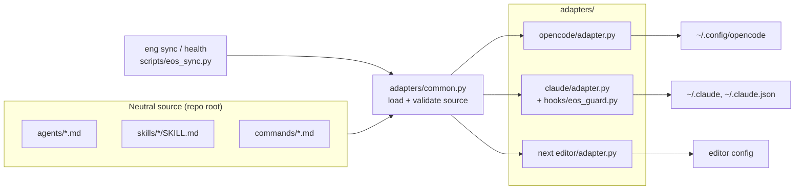
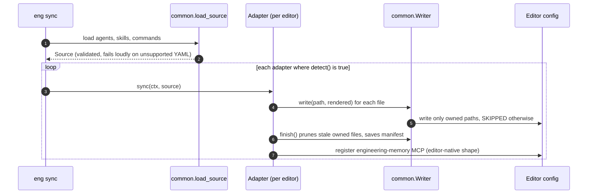
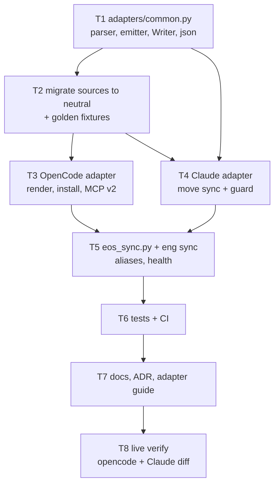

# Design: editor-neutral engine (adapters)

- **Status:** Approved for implementation (2026-10-10)
- **Supersedes (paths only):** the `opencode/` source layout described in
  `docs/architecture.md` and ADR 2026-10-10 "Claude Code support via generated config"

## Problem

Agents, skills and commands live in `opencode/` and use OpenCode's frontmatter
(`mode`, `temperature`, `permission`, OpenCode model ids). Every other editor has
to be translated *from OpenCode's dialect*, so OpenCode is the de facto spec.
We plan to support many editors (OpenCode, Claude Code, then Codex, Cursor,
Gemini CLI, ...). Each new one should be one adapter, not another special case.

Found while auditing (fixed by this work):

- `eng sync-opencode` writes the MCP entry in the OpenCode **v1** shape
  (`mcp.engineering-memory`). The installed OpenCode is **v2** (`mcp.servers.*`,
  `timeout: {catalog, execution}`), so every re-sync re-adds a stale v1 key.
- OpenCode install is copy-based (`~/.config/opencode/*` are copies), so moving
  sources cannot break a running install; only the next sync reads them.

## Requirements

- One neutral source of truth for agents, skills, commands. No editor's name in
  the source layout.
- Each editor = one adapter with the same contract: detect, sync, health.
- Shared safety rules in one place: never overwrite files we did not write,
  prune only what we wrote, fail-closed permission translation, safe JSON merge.
- **Zero behaviour change** for the working OpenCode and Claude Code installs:
  - OpenCode: `opencode debug agents` output identical before and after.
  - Claude Code: generated `~/.claude` files identical except the
    "Generated from" source path.
- Existing commands keep working: `eng setup`, `eng health`, `eng sync-opencode`,
  `eng sync-claude`. Stdlib only. Idempotent.

## Architecture





### Neutral source format

Same Markdown + frontmatter, editor-neutral keys. Editor-only settings go under
`targets.<editor>` and are passed through by that editor's adapter only.

```yaml
# agents/explorer.md
---
name: explorer
description: >-
  Read-only repository explorer. ...
role: subagent            # primary | subagent
model_tier: fast          # deep | standard | fast (adapters map to models)
permissions:              # neutral policy; allow / deny / ask, pattern maps
  read: allow
  edit: deny
  bash:
    "*": deny
    "git log *": allow
targets:
  opencode:
    temperature: 0.1
---
```

- `permissions` keeps the allow/deny/pattern shape we already use. It is a good
  editor-neutral policy language, and OpenCode consumes it as is.
- `targets.opencode.model` holds the OpenCode model id; `targets.claude.model`
  can override the tier mapping.
- Commands: `description` plus `targets.opencode.{agent, subtask}`.
- Skills: unchanged (`name`, `description`, `metadata`).
- Bodies keep their current wording; each adapter may prepend a tool-name note
  (Claude does today).

### Adapter contract

```python
NAME = "opencode"
def detect(ctx) -> bool          # is this editor installed?
def sync(ctx, source) -> None    # render + install + register MCP
def health(ctx, source) -> None  # print status lines ("not installed" when undetected)
```

`ctx` carries engine, data, python, home and env-derived paths. `source` is the
validated neutral source. Adding an editor = one `adapters/<name>/adapter.py`
plus a line in the registry, tests, and docs.

### Shared layer (`adapters/common.py`)

- Frontmatter parser (stdlib subset) that **fails loudly** on syntax it does not
  support (lists, anchors), plus an order-preserving YAML emitter.
- `Writer`: ownership manifest per editor dir. Writes only owned paths, prints
  `SKIPPED` otherwise, prunes stale owned files. `adopt_legacy` lets the
  OpenCode adapter take over files the old copy-based sync wrote (first run
  only, matching today's behaviour).
- JSON/JSONC load, atomic write with backup.
- Permission semantics helpers (fail closed: only exact `allow` grants).

## Alternatives

- **Keep `opencode/` and add per-editor converters.** Zero churn now; OpenCode
  stays the spec and its quirks leak into every adapter. Rejected.
- **Fully abstract schema, no `targets` escape hatch.** Breaks the first time an
  editor has a setting with no shared meaning. Rejected.
- **Packaging per tool (plugins).** A possible adapter *output*, not a source of
  truth. Deferred.
- **Real YAML library.** Violates the stdlib-only rule. The subset parser plus
  loud validation is enough for our own files.

## Failure modes and mitigations

| Failure | Mitigation |
|---|---|
| Neutral file uses YAML the parser cannot read | Loader raises with file:line; sync aborts before writing anything |
| OpenCode output drifts semantically | Golden test: render vs frozen fixtures of the pre-migration `opencode/` files, compared as parsed frontmatter + body |
| Permission rule order changes meaning | Emitter preserves key order; golden test compares ordered maps |
| Numbers/booleans emitted as strings (`temperature: "0.1"`) | Emitter writes numeric/boolean scalars unquoted; golden test parses with `typed=True`, so quoting drift fails it |
| First OpenCode sync skips files written by the old sync | `adopt_legacy` when no manifest exists |
| Guard path moves; Claude sessions already running keep the old hook path until restart (and a rollback to `main` points the other way) | Compatibility shim at `claude/hooks/eos_guard.py` forwards to the new guard and exits 2 if it is missing (fail closed). Remove after one release |
| OpenCode v1 vs v2 MCP shape | Prefer the shape the config already uses; else the major from the first line of `opencode --version` (stdout or stderr, full x.y.z only); else keep an existing v1 entry; else v2. The choice and reason are logged; `eng health` warns on a shape/version mismatch. The stale v1 key is removed only if it points at our server |
| Permission rule order differs per editor (OpenCode: last match wins) | Loader requires the `"*"` default to be the first rule; Claude guard checks deny rules before allows (never wider than OpenCode) |
| Shared JSON config loses JSONC comments on write | The first `.engineeringos.bak` is kept forever (the user's original); trailing commas accepted |

## Security

Permission translation and the Claude guard are security controls. They move,
unchanged in behaviour, into the shared layer and the Claude adapter; their
tests move with them and stay in CI. Nothing new is sent off the machine.

## Testing strategy

1. Unit: parser/emitter round trip, loud failures, permission translation.
2. Golden: OpenCode adapter output == frozen pre-migration fixtures (semantic).
3. Existing Claude sync suite, repointed to the new paths (86 checks).
4. Hermetic `eng` tests for `sync`, aliases, `health`.
5. Live verification on the operator machine: snapshot `opencode debug agents`
   and `~/.claude` before, sync, diff after.

## Implementation plan



| Task | Acceptance criteria |
|---|---|
| T1 shared layer | Parser round-trips every current source file; unsupported YAML raises with file:line; Writer tests (owned, skipped, prune, adopt_legacy) pass |
| T2 migrate sources | `git mv` keeps history; neutral frontmatter only; fixtures of old files committed under `tests/fixtures/opencode-v1/` |
| T3 OpenCode adapter | Golden test green for all agents, commands, skills; MCP written in v2 shape; stale v1 key removed only if ours; `default_agent` respected |
| T4 Claude adapter | All existing Claude checks green; generated files identical except source path |
| T5 CLI | `eng sync [--target]`, `eng sync-opencode`, `eng sync-claude`, `eng setup`, `eng health` work; usage updated |
| T6 tests/CI | CI runs every suite; all green |
| T7 docs | README, AGENTS.md, CONTRIBUTING, architecture.md, SECURITY.md paths updated; `docs/adapters.md` guide; ADR |
| T8 live verify | `opencode debug agents` diff empty; `~/.claude` diff only source-path comments; OpenCode probe reaches the memory MCP |

## Human decisions

- Layout: root-level `agents/`, `skills/`, `commands/` (chosen, recommended).
- Next editors after OpenCode and Claude: open. The contract is designed so the
  third adapter (likely Codex: `AGENTS.md` + TOML MCP) is additive.
